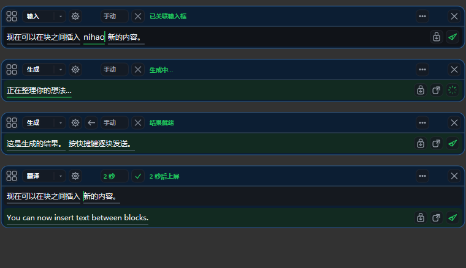
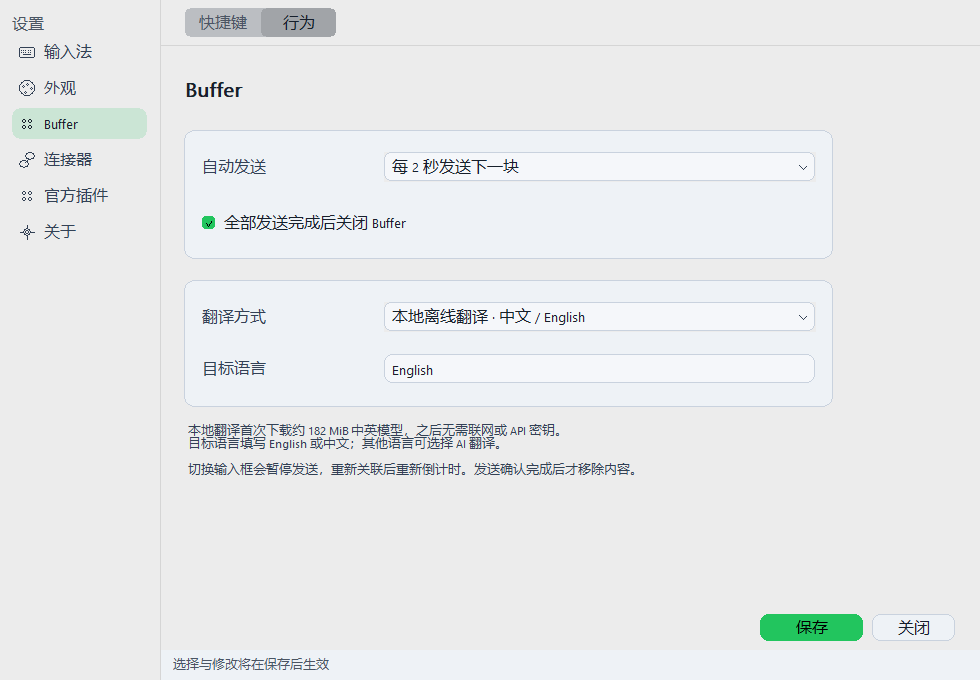

# Windows Buffer 对齐修复与验收记录

日期：2026-10-12。修复基线：`6b90e48`。分支：`codex/windows-buffer-parity-20261012`。

用户确认了初始诊断，并纠正 B09 为「快捷键完全不能发送，只有点击有效」。本次改动按该反馈实施。没有更新日用输入法安装；以下是源码、隔离运行和生产绘制代码的证据，不代表浏览器、Codex 或 Mac 实机逐像素验收。

## 行为改动

| 范围 | 实现 |
| --- | --- |
| 本机翻译 | 默认 CTranslate2 CPU int8 + Argos/OPUS-MT 中英模型；第一次联网下载约 182 MiB 并验证 SHA-256，以后离线。保留 AI 翻译可选项；不支持的本地语言明确失败，不回退上屏原文。 |
| 快捷键发送 | Buffer 捕获且无组字时注册配置的系统热键，解决宿主吞掉 Alt+Shift+Enter 的路径；与 TSF 共用 tap/hold 和逐块 ACK 队列。短按一块、按住 1 秒发送当时的队列，之后新增内容不进入本轮。 |
| 候选定位 | Broker 发布实际 Buffer 逻辑插入点，TSF 复验 context/opening/session；捕获期间不再回退到宿主位置。 |
| 源文编辑 | 左右/Home/End 块间定位、点击块边界、Delete/Backspace、Ctrl+A/V/C；长输入自动滚动到插入点，Ctrl+A/V 先结束当前组字。 |
| 翻译生命周期 | 原文在首个译文子块确认时退休；剩余译文独立保留；尾部改动保留未受影响的完整译文，取消过期任务。 |
| AI 工作区 | 原文、生成中和结果在同一轨道切换；生成按钮/等待反馈/返回编辑入口。完整结果复制经身份与版本复验，剪贴板成功写入后关闭。 |
| 功能栏 | 目标应用图标与绑定状态、当前插件配置、自动发送间隔、倒计时、末块确认后关闭。切换焦点暂停并重新计算倒计时。 |
| 设置 | Alt+Shift+S 打开；新增 Buffer 行为页，统一字体层级、分组、下拉框/按钮、主题与分段导航；保存持久化翻译方式、间隔和关闭偏好。 |

自动发送默认关闭；末块发送后关闭默认开启。投递继续通过原生 TSF edit session，未使用剪贴板粘贴或模拟宿主按键。API 密钥存储与插件授权机制继续有效。

## 验证

- MSVC Release x64/x86 完整编译通过，CTest 两种架构各 **27/27 通过**。覆盖快捷键 tap/hold、队列冻结、焦点变更、自动发送、最后 ACK 关闭、剪贴板失败/过期 ticket、块间编辑、翻译退休和 Buffer caret 隔离。
- 独立 librime + 测试 TSF context 的集成流程在 x64/x86 均通过，检查输入、候选、Shift 手势、caret 隔离及 Broker 维护退出。不会注册或替换日用输入法。结果与二进制摘要见 [build-evidence.json](build-evidence.json)。
- 本机翻译从锁定资源安装到临时目录，经原生 provider 调用实际模型，双向结果如下；不支持的语言返回错误且 stdout 无原文。

| 输入 | 实际输出 |
| --- | --- |
| 今天天气很好，我们下午去公园散步。 | It's a nice day. We'll go for a walk in the park this afternoon. |
| Please save the document before closing the window. | 请在关闭窗口前保存文档。 |

- Provider transport 测试 7 项、native-data 单元测试 11 项通过；静态 foundation 检查两种架构通过。
- `RimesVisualPreview --export=绝对目录` 使用实际 Buffer painter 和 SettingsUiHost 隐藏控件导出 4 种主题、Buffer 96/144/192 DPI 和四个设置页面。不抓取用户桌面；输入框文字由同一控件读取后绘制到离屏画布。
- 本地 Temp 下 MSBuild 的增量依赖跟踪曾造成不一致对象文件；最终证据使用完整重编译，再执行原生和集成测试。
- Windows CI 增加无凭据的真实本地翻译 smoke，产物与安装包包含翻译安装脚本、锁文件、执行脚本和许可证说明；权重在首次使用时下载，不提交入仓库。

以下为生产绘制代码的离屏预览，采用合成文字，非日用桌面截图：

## 用户实机验收

安装本分支的新产物后，在浏览器测试输入框和 Codex 草稿框各执行一次，不需要发送聊天消息：

1. Alt+Shift+B 打开，输入三个块。短按 Alt+Shift+Enter 只进一块；再次长按满 1 秒，剩余块各进一次，默认末块后关闭。
2. 拖动 Buffer 后输入拼音；候选跟随 Buffer 里的拼音光标。连续输入长文本，最新光标持续可见。
3. 在块间插入、Home/End、Ctrl+A 后粘贴；检查内容只改变 Buffer，宿主草稿不被全选或粘贴。
4. 选择翻译，首次资源下载结束后检查中英结果；断网再翻译。译文为空或下载失败时不得把原文当译文发出。
5. AI 生成经历原文→等待→结果单轨；返回编辑、重新生成，复制完整结果后关闭且不投递宿主。
6. 设置 2 秒自动发送，倒计时中切换输入框：不能发往新框。重新关联后重新计时。关闭「发送后关闭」后末块发送仍保持面板。
7. Alt+Shift+S 打开设置，检查 100%/150%/200% 显示缩放、日/夜主题和快捷键录入、配置持久化。

本地模型当前只覆盖中英，首次下载的网络可达性和日用宿主的真实快捷键路由仍需上述实机确认。Mac 基线来自仓库源码，未声称 Windows 与运行中的 Mac 达成逐像素一致。
